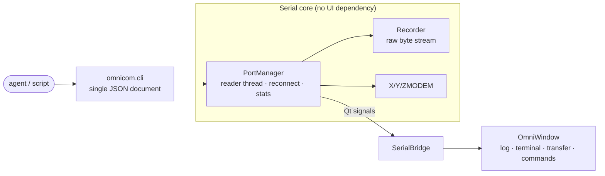

<div align="center">


# OmniCOM

**A native serial workbench: one window instead of a serial assistant, a terminal,
a transfer tool and a script interface.**


[Quick start](#quick-start) · [Features](#features) · [Portable build](#portable-build) · [CLI](#command-line-interface) · [Manual](#user-manual) · [Verify](#verify)

</div>

---

## Why

Embedded debugging usually means juggling four or five programs: one to watch the
port, one to send commands, one to flash firmware, and a script to keep the log.
OmniCOM folds all of that into a single native window - with no runtime tax: no
local web server, no browser, and no self-built executable in the distribution.

| | The usual setup | OmniCOM |
| --- | --- | --- |
| Interface | browser shell / one text box | native Qt window, light theme, glass panes |
| Commands | a script or a notepad file | a command library with groups and notes, importable/exportable |
| Transfer | a separate protocol tool | XMODEM / YMODEM / ZMODEM built in |
| Automation | clicking only | a single-JSON CLI for agents and scripts |
| Distribution | install Python, install deps | a portable folder, unzip and run |

## Features

<table>
<tr><td width="50%" valign="top">

**Receive & send**

- Millisecond timestamps, direction markers, visible control characters
- HEX send/receive, timed send, per-command delays
- Log buffered by **byte budget** (100 MB default)
- Oldest lines dropped first; the dropped count stays visible
- Nothing is ever dropped silently - every loss is counted and reported

**Command library**

- Group collapse is instant: no rebuild, no disk write
- A note per command, aligned with the command text
- Export/import one command or a whole group; same-name groups merge
- Paste multi-line text and it splits into entries

</td><td width="50%" valign="top">

**Transfer & terminal**

- XMODEM / YMODEM / ZMODEM, send and receive
- Sent files are printed to the log like normal sends, with a progress bar
- Terminal page understands the usual ANSI cursor and colour sequences
- Both directions recorded into one byte-exact file

**Engineering**

- Chinese and English strictly separated, never mixed
- Plugins are folders: copy one in and press reload
- Keyword search: plain / fuzzy / whole word / regex
- Launcher with two rows, multiple windows bound to their own targets

</td></tr>
</table>

## Quick start

```bash
git clone https://github.com/Fatmear/OmniCOM.git
cd OmniCOM
start.cmd                  # or: python run.py
```

Requires Python 3.13 and PySide6:

```bash
python -m pip install -r requirements.txt
```

No hardware needed to try it:

```bash
python run.py --demo       # virtual DEMO port: answers AT and streams telemetry
```

## Portable build

```bash
python tools/make_dist.py --check --zip
```

Output:

```
dist/OmniCOM/                # 98 MB with the bundled runtime
├── OmniCOM.cmd              # double-click to start (no console window)
├── console.cmd              # same, keeps a console for tracebacks
├── OmniCOM.pyz              # the program (also a readable source archive)
├── CLI.md / AI-GUIDE.md     # the command-line contract for agents and scripts
├── runtime/                 # official CPython embeddable + trimmed Qt bindings
├── assets/  plugins/  logo.png
└── README.md / README.en.md

dist/OmniCOM-1.1.2-win64.zip
```

Unzip and double-click `OmniCOM.cmd`. The target machine needs **no Python, no
PySide6, no pip**; the folder is relocatable (USB stick included). The first run
creates `omnicom-data/` beside it.

## Command-line interface

The same entry point is the machine interface - `stdout` carries exactly one JSON
document, so `json.loads` and `| jq` both work:

```bash
OmniCOM.cmd cli info                      # environment check
OmniCOM.cmd cli ports                     # list serial ports
OmniCOM.cmd cli send --port COM3 --data "AT" --expect OK --wait 2
OmniCOM.cmd cli monitor --port COM3 --duration 5 --grep ERROR
OmniCOM.cmd cli transfer --port COM3 --proto y --dir send --file app.bin
OmniCOM.cmd cli session --port COM3 --script steps.json   # the agent entry point
OmniCOM.cmd cli selftest                  # end-to-end check without hardware
```

From source the equivalent is `python -m omnicom.cli`. Full reference:
[`docs/CLI.md`](docs/CLI.md).

## Architecture



The window only talks to the port through `SerialBridge` signals; drivers are
opened, closed and joined off the GUI thread, so a busy window cannot lose
incoming bytes.

## Verify

```bash
python tools/acceptance_test.py     # requirement sweep, with executable evidence
python tools/ui_selftest.py         # GUI acceptance (offscreen, no hardware)
python tools/protocol_selftest.py   # X / Y / ZMODEM loopback
python -m ruff check .              # style
```

Requirements live in `project-context/REQUIREMENTS.md`; findings and closed
defects in `project-context/LEDGER.md`.

## Where the data lives

| Path | Contents |
| --- | --- |
| `omnicom-data/logs/` | Raw receive captures |
| `omnicom-data/received/` | Files received over a protocol |
| `omnicom-data/commands.json` | Commands and groups |
| `omnicom-data/plugins/` | Plugins added later |
| `omnicom-data/plugin-data/<id>/` | Each plugin's own data |

`OMNICOM_DATA_DIR` moves the whole thing somewhere else.

## User manual

### 1. Quick start

* Double-click `start.cmd`, or run `python run.py`. Add `--demo` for a virtual DEMO port.
* No extra console window opens on launch; add `--keep-console` to keep one.
* To hand the app to someone else run `python tools/make_dist.py --zip` and send the `dist/OmniCOM/` folder (or the zip of the same name): it bundles the Python runtime and every dependency, so nothing has to be installed - `OmniCOM.cmd` starts the app.
* Pick a port on the left, set the parameters, then press *Open port* - data starts appearing on the *Serial log* page.
* Click the baud field and type a custom value. Enter or moving focus applies it; the dropdown still offers common rates.
* Type in the box at the bottom and press Ctrl+Enter or *Send*. Line ending, HEX and timed send live to its right.
* Drag the divider above the composer to grow the actual text editor; its height is restored on the next launch.

### 2. Serial log

* Each line reads `[hh:mm:ss.mmm]RX←◇payload` (received) or `TX→◇payload` (sent). Switch the language and the two direction markers change with it.
* *Auto-scroll to latest* always follows the newest line. Turn it off and a *back to latest* bubble appears while you read history.
* *Keep screen awake* stops Windows from blanking or sleeping on idle - handy during a long capture. It is released automatically when OmniCOM closes.
* *Show \r \n and other control chars* applies to both directions, so you can see the line ending that was really sent.
* *HEX view* prints 16 bytes per line: offset, hex, ASCII.
* Clearing the log also resets the RX/TX counters in the title bar.
The log is buffered by size: 100 MB of text by default (4-500 MB in Preferences).
When it is full the oldest lines are dropped and the newest are always kept; the log
toolbar reports how many lines went, and a fast peer never stalls the window.
File sending is two steps: *Open file* chooses the pending file, *Send file* transmits it;
the bytes are printed as normal send lines and a progress bar tracks the transfer.
* *Save view* writes the log to a file. *Capture RX + TX* writes every byte of both directions to one file in the background and never misses a byte, regardless of what the UI shows. *Clear capture file* empties it and keeps recording.
* Right-click the log to copy, copy all, save, find or jump to latest.
* The port button is neutral while disconnected and coloured only when connected. Opening and closing run in the background; the button is temporarily disabled.

### 3. Terminal

* A real console page for a linux serial login: click it and every keystroke goes out.
* Enter sends CR (selectable CR/LF/CRLF), Ctrl+C sends 0x03, arrow keys send ANSI.
* Handles CR-overwrite, backspace, TAB, ANSI colours and clear-screen sequences.
* Copy with Ctrl+Shift+C, paste with Ctrl+Shift+V (plain Ctrl+C is the interrupt byte).

### 4. File transfer

* Pick XMODEM / YMODEM / ZMODEM, choose direction and file, press Start.
* Received files land in `omnicom-data/received/`.
* The port is exclusive during a transfer, so the log page stays quiet.

### 5. Commands

* Click a command to send it, or tick several and press *Send in order* (each keeps its own delay).
* *Groups* organise them: the folder button creates one, groups take a note, and they collapse. Creating or renaming a group rejects existing names after trimming leading and trailing whitespace.
* Each command and its send/edit/delete actions share one primary line. A colour strip shows selection; notes appear below in smaller text. Hover for full text and delay.
* Every command supports a note, line ending, delay, timed repeat and HEX.
* Right-click a command to move groups. Use the export button at the top to select commands or a group to export.
* The exported JSON can be imported on another machine - groups merge automatically.
* Pasting several lines creates several commands.

### 6. Search

* Type a keyword and press Enter: it searches **the whole log, history included**, and lists hits as `line-number  text`.
* Select log text and right-click Find to replace the old query and search literally. A multi-line selection matches any of its lines.
* Double-click any row to jump to that line in the log; it flashes.
* Modes: Plain / Fuzzy (characters in order) / Whole word / Regex, plus a *Match case* switch.
* The expand arrow blows the results up to the full window; Esc exits.

### 7. Plugins

* A plugin is a folder under `plugins/` or `omnicom-data/plugins/`; each one gets its own tab in the top bar.
* Copy the whole folder to another machine's `plugins/`, press *Plugins → Reload* and it is installed.
* Ships with *Launcher*: the top row holds shortcuts (click opens a new window) and the bottom row holds running windows (click to switch to that window).
* Both rows can be reordered by dragging. Rename a running window to tell two instances apart (A and B); long names wrap instead of being covered.
* Removing a shortcut keeps its windows open; *End this window* closes just that one window.

### 8. Preferences and language

* *Settings → Preferences* switches the interface language. Chinese shows only Chinese, English only English - context menus included.
* The same page sets the log buffer size (4-500 MB, 100 MB by default), the default capture folder, a solid accent colour, or a wallpaper image. With a wallpaper the panes - and the hover tooltip - become liquid glass: the blurred photo behind them plus a translucent white wash; without one they stay plain white. The bottom status captions have no frame or fill at all, just text.
* The change applies immediately, no restart.

### 9. Command line (for scripts / AI)

* `python -m omnicom.cli ports` lists ports; `send` sends and waits for a reply; `read` reads; `monitor` streams.
* `session --script file.json` runs a scripted exchange.
* Every command writes exactly one JSON document to stdout; see `docs/CLI.md`.

### 10. Where the data lives

* `omnicom-data/logs/` captures (or the folder chosen in Preferences), `omnicom-data/received/` transferred files,
* `omnicom-data/commands.json` commands, `omnicom-data/plugins/` extra plugins. The *Records* label in the bottom-right corner shows the folder captures really go to.

---

## Licence

MIT License - see [`LICENSE`](LICENSE). Free for commercial use, modification and
redistribution; keep the copyright and permission notice.

<div align="center">
<sub>Built with Qt / PySide6 · made for embedded debugging</sub>
</div>
