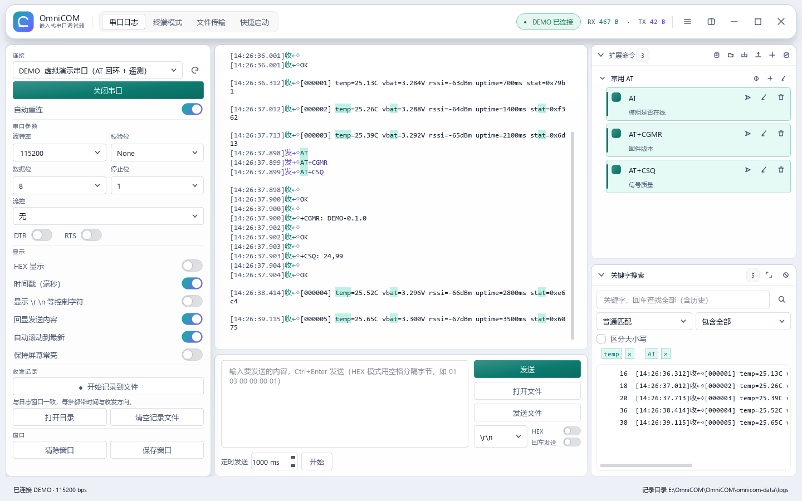
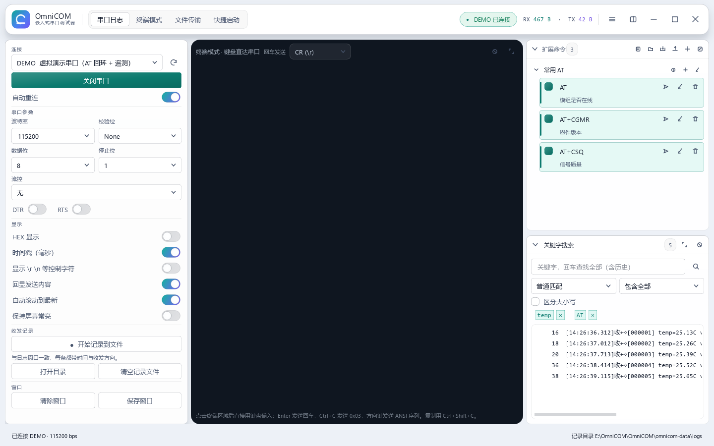
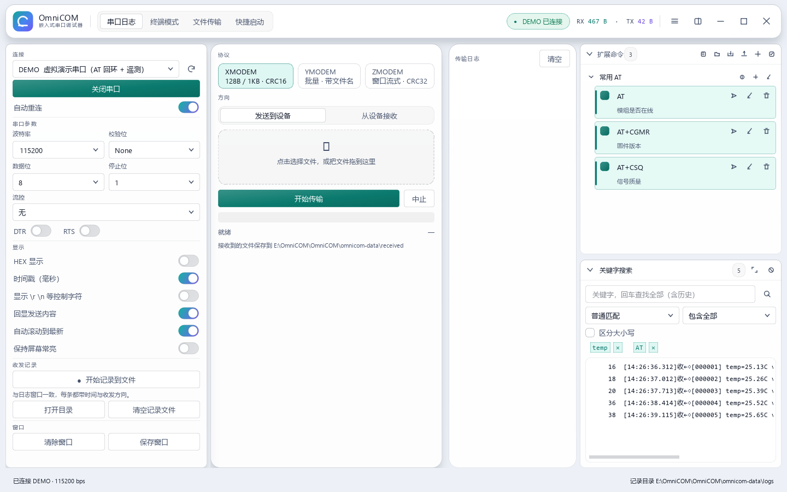
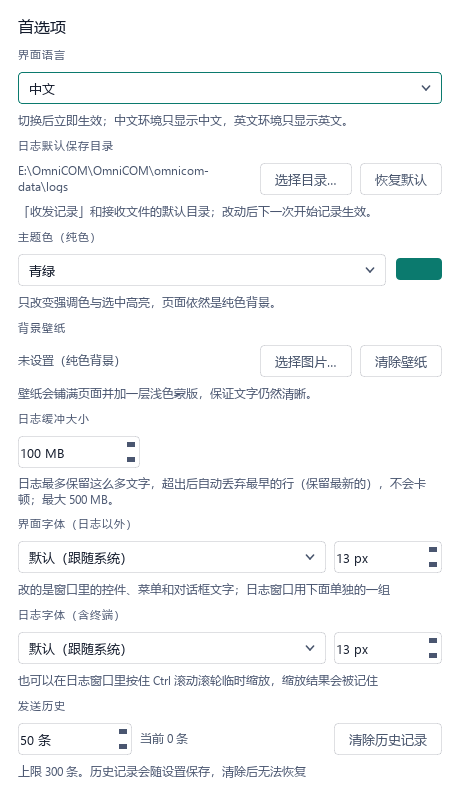
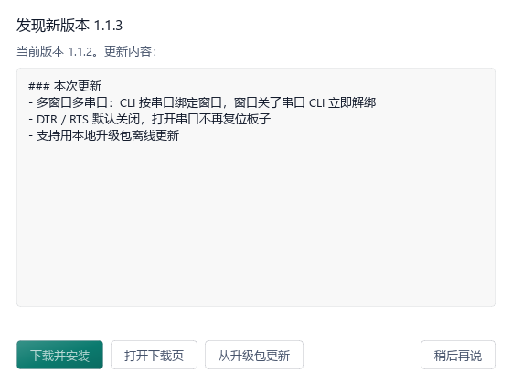
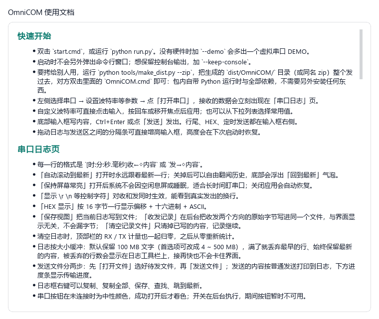
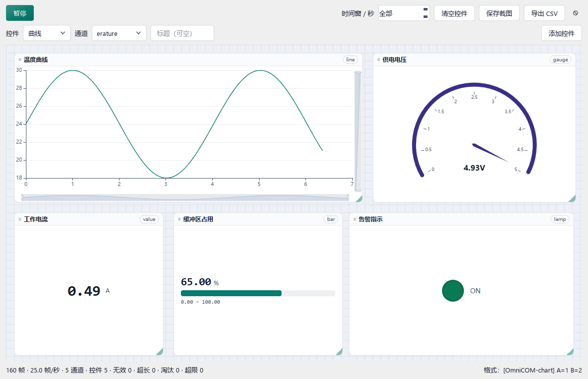
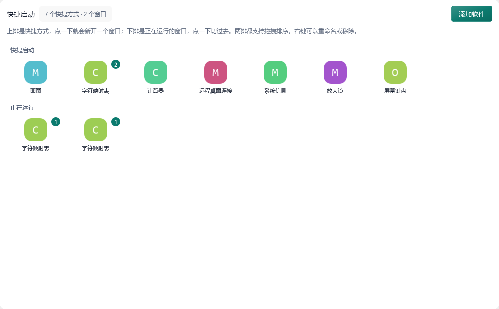
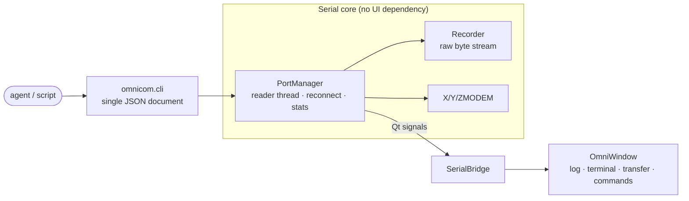

<div align="center">


# OmniCOM

**A native serial workbench: one window instead of a serial assistant, a terminal,
a transfer tool and a script interface.**


[Quick start](#quick-start) · [Features](#features) · [Plugins](#plugins) · [Portable build](#portable-build) · [CLI](#command-line-interface) · [Manual](#user-manual) · [Verify](#verify)

</div>

---

## Why

Embedded debugging usually means juggling four or five programs: one to watch the
port, one to send commands, one to flash firmware, and a script to keep the log.
OmniCOM folds all of that into a single native window - with no runtime tax: no
local web server, no browser, and no self-built executable in the distribution.

| | The usual setup | OmniCOM |
| --- | --- | --- |
| Interface | browser shell / one text box | native Qt window, light theme, glass panes |
| Commands | a script or a notepad file | a command library with groups and notes, importable/exportable |
| Transfer | a separate protocol tool | XMODEM / YMODEM / ZMODEM built in |
| Automation | clicking only | a single-JSON CLI for agents and scripts |
| Distribution | install Python, install deps | a portable folder, unzip and run |

### Four concrete problems it solves

**1. The log is visible - and keeps itself.** Every line carries a millisecond timestamp and a direction marker; control bytes (CR / LF / 0x00) can be drawn explicitly so protocol bugs stop being guesswork. The log is buffered by a **byte budget** (100 MB by default, 4-500 MB in Preferences): the oldest lines go first and the dropped count stays on the toolbar, so a chatty device can neither freeze the UI nor lose bytes silently.

**2. Commands are not throwaway typing.** The library supports groups, notes, line endings, delays, periodic sends and HEX; a whole group can be sent in order, exported as JSON for a colleague, and pasted multi-line text splits into entries automatically. Collapsing a group is instant - no list rebuild, no disk write.

**3. Firmware transfer needs no second tool.** XMODEM / YMODEM / ZMODEM are built in; a plain file send is printed to the log like any other send, with a progress bar and live throughput; received files land in `omnicom-data/received/`.

**4. A machine can drive it too.** The same entry point is a CLI whose `stdout` is one JSON document, ready for `json.loads`. While a window is open the CLI **does not grab the port**: it hands the request to the window that already owns it, so what you see on screen is what the agent sees - and when the window closes the port, the CLI's binding ends immediately instead of writing into nothing.

### Deliberate trade-offs

- **No web UI**: no local HTTP service, no browser engine - the window *is* the interface.
- **No self-built exe**: the portable folder ships the official CPython runtime plus trimmed Qt bindings; double-click `OmniCOM.cmd`, no antivirus drama, nothing to install.
- **Settings live in files**: `settings.ini` plus a per-window `window-<n>.ini`, so a portable copy never inherits an older install's registry.
- **Chinese and English strictly separated**: no mixed strings, context menus included; a test scans the English UI for leftover CJK characters.
- **DTR / RTS start low**: many USB-serial boards wire DTR to RESET through a capacitor, so raising it would reboot the device every time the port opens.

## Screenshots



<sub>1440x900 - port and display options on the left, the *Serial log / Terminal / File transfer* pages in the middle, the command library and keyword search on the right, the composer and timed send at the bottom.</sub>

<table>
<tr>
<td width="33%" valign="top"><br>
<sub><b>Terminal</b>: the keyboard goes straight to the port; Enter / Ctrl+C / arrow keys send what the device expects.</sub></td>
<td width="33%" valign="top"><br>
<sub><b>File transfer</b>: XMODEM / YMODEM / ZMODEM with live progress and throughput.</sub></td>
<td width="33%" valign="top"><br>
<sub><b>Preferences</b>: language, log budget, fonts, accent, wallpaper, send history.</sub></td>
</tr>
</table>

<table>
<tr>
<td width="50%" valign="top"><br>
<sub><b>Software update</b>: checks online, or installs a local release package offline.</sub></td>
<td width="50%" valign="top"><br>
<sub><b>Built-in manual</b>: the same source as this README, so they cannot drift.</sub></td>
</tr>
</table>

The screenshots are rendered by `python tools/make_screenshots.py` from the real program (virtual DEMO port), not mocked up.
The plugin pictures come from `python tools/make_plugin_screenshots.py`, which grabs the live plugin pages.

## Features

<table>
<tr><td width="50%" valign="top">

**Receive & send**

- Millisecond timestamps, direction markers, visible control characters
- HEX send/receive, timed send, per-command delays
- Log buffered by **byte budget** (100 MB default)
- Oldest lines dropped first; the dropped count stays visible
- Nothing is ever dropped silently - every loss is counted and reported

**Command library**

- Group collapse is instant: no rebuild, no disk write
- A note per command, aligned with the command text
- Export/import one command or a whole group; same-name groups merge
- Paste multi-line text and it splits into entries

</td><td width="50%" valign="top">

**Transfer & terminal**

- XMODEM / YMODEM / ZMODEM, send and receive
- Sent files are printed to the log like normal sends, with a progress bar
- Terminal page understands the usual ANSI cursor and colour sequences
- Both directions recorded into one byte-exact file

**Engineering**

- Chinese and English strictly separated, never mixed
- Plugins are folders: copy one in and press reload
- Keyword search: plain / fuzzy / whole word / regex
- Launcher with two rows, multiple windows bound to their own targets

</td></tr>
</table>

## Plugins

A plugin is a self-contained folder (`plugin.json` plus an entry module) dropped
into `plugins/` or `omnicom-data/plugins/`; each one gets its own tab at the top
of the window. *Plugins -> Plugin store* installs, updates, downgrades and
removes them by version, and uninstalling keeps the plugin's own user data. Two
plugins ship with the program.

### Dashboard · `chart`



<sub>Rendered from the live program: five widgets, each bound to its own channel,
every readout parsed out of `[OmniCOM-chart]` lines. `python tools/make_plugin_screenshots.py`
regenerates it and reads the page DOM back first - if one card still says `--`
the run fails instead of producing a picture.</sub>

If the device prints one line of text, the dashboard grows by itself:

```
[OmniCOM-chart] temperature=24.6 supply=4.87 current=0.49 level=65 alarm=1
```

| Widget | How it shows the value | Good for |
| --- | --- | --- |
| Line | ECharts polyline, x axis is receive time | trends, jitter, step response |
| Gauge | half dial pointing at the value within `min`/`max` | anything with bounds, e.g. voltage |
| Value | one big number plus its unit (2 decimals by default) | a reading without a plot |
| Bar | fill computed from the card's own min/max | buffer usage, completion |
| Lamp | lit when the value is non-zero, reads ON / OFF | alarm and status bits |

- **Channels are discovered**: every key in the line becomes a channel (128 max), nothing to configure up front.
- **The bar respects its range**: below the minimum it is empty, above the maximum it fills and turns red, and the caption shows the range (`0.00 - 100.00`) with the unit; with no data it reads `--`.
- **Layout is direct**: drag a card anywhere, drag its bottom-right corner to resize; the grid background stays visible so alignment is obvious. There is no edit-mode switch to find.
- **Each line card carries its own two zoom sliders**, one for the time axis and one for the value axis; pressing on a slider zooms, pressing anywhere else on the card still drags it.
- **5000 points per channel** are kept, the time window defaults to *all*, nothing is decimated, and a live refresh never resets your zoom.
- **Export**: CSV for the numbers, PNG for the picture; dropped history, invalid lines, over-long lines and the channel ceiling are counted separately, never silently lost.

### Launcher · `launcher`



<sub>Rendered from the live program: the top row comes from `apps.json`, the bottom
row is a genuine window enumeration (the windows in the picture are started by the
script itself, so none of this machine's own document titles end up in it).</sub>

- **The top row is shortcuts**: one click opens a new instance - debugging two boards at once means one window per board, so the logs never interleave.
- **The bottom row is what is already running**: one click switches to that window; several windows of the same program are listed separately and can be named A, B.
- **Both rows can be reordered by dragging** and renamed from the context menu (the bottom row defaults to the window title, and long titles wrap instead of being clipped).
- **Remove from list** (top row) only deletes the shortcut and leaves the window open; **End this window (process)** (bottom row) closes exactly that one.
- While the page is on screen the window list is rescanned every 4 s on a background thread, so an unresponsive program cannot freeze the window.
- The list lives in `omnicom-data/plugin-data/launcher/apps.json`; only `path` is required, and `name` is yours to choose.

## Quick start

```bash
git clone https://github.com/Fatmear/OmniCOM.git
cd OmniCOM
start.cmd                  # or: python run.py
```

Requires Python 3.13 and PySide6:

```bash
python -m pip install -r requirements.txt
```

No hardware needed to try it:

```bash
python run.py --demo       # virtual DEMO port: answers AT and streams telemetry
```

## Portable build

```bash
python tools/make_dist.py --check --zip
```

Output:

```
dist/OmniCOM/                # 98 MB with the bundled runtime
├── OmniCOM.cmd              # double-click to start (no console window)
├── console.cmd              # same, keeps a console for tracebacks
├── OmniCOM.pyz              # the program (also a readable source archive)
├── CLI.md / AI-GUIDE.md     # the command-line contract for agents and scripts
├── runtime/                 # official CPython embeddable + trimmed Qt bindings
├── assets/  plugins/  logo.png
└── README.md / README.en.md

dist/OmniCOM-1.1.5-win64.zip
```

Unzip and double-click `OmniCOM.cmd`. The target machine needs **no Python, no
PySide6, no pip**; the folder is relocatable (USB stick included). The first run
creates `omnicom-data/` beside it.

## Command-line interface

The same entry point is the machine interface - `stdout` carries exactly one JSON
document, so `json.loads` and `| jq` both work:

```bash
OmniCOM.cmd cli info                      # environment check
OmniCOM.cmd cli ports                     # list serial ports
OmniCOM.cmd cli send --port COM3 --data "AT" --expect OK --wait 2
OmniCOM.cmd cli monitor --port COM3 --duration 5 --grep ERROR
OmniCOM.cmd cli transfer --port COM3 --proto y --dir send --file app.bin
OmniCOM.cmd cli session --port COM3 --script steps.json   # the agent entry point
OmniCOM.cmd cli selftest                  # end-to-end check without hardware
```

From source the equivalent is `python -m omnicom.cli`. Full reference:
[`docs/CLI.md`](docs/CLI.md).

## Architecture



The window only talks to the port through `SerialBridge` signals; drivers are
opened, closed and joined off the GUI thread, so a busy window cannot lose
incoming bytes.

## Verify

```bash
python tools/acceptance_test.py     # requirement sweep, with executable evidence
python tools/ui_selftest.py         # GUI acceptance (offscreen, no hardware)
python tools/protocol_selftest.py   # X / Y / ZMODEM loopback
python -m ruff check .              # style
```

Requirements live in `project-context/REQUIREMENTS.md`; findings and closed
defects in `project-context/LEDGER.md`.

## Where the data lives

| Path | Contents |
| --- | --- |
| `omnicom-data/logs/` | Raw receive captures |
| `omnicom-data/received/` | Files received over a protocol |
| `omnicom-data/commands.json` | Commands and groups |
| `omnicom-data/plugins/` | Plugins added later |
| `omnicom-data/plugin-data/<id>/` | Each plugin's own data |

`OMNICOM_DATA_DIR` moves the whole thing somewhere else.

## User manual

### 1. Quick start

* Double-click `start.cmd`, or run `python run.py`. Add `--demo` for a virtual DEMO port.
* No extra console window opens on launch; add `--keep-console` to keep one.
* To hand the app to someone else run `python tools/make_dist.py --zip` and send the `dist/OmniCOM/` folder (or the zip of the same name): it bundles the Python runtime and every dependency, so nothing has to be installed - `OmniCOM.cmd` starts the app.
* Pick a port on the left, set the parameters, then press *Open port* - data starts appearing on the *Serial log* page.
* Click the baud field and type a custom value. Enter or moving focus applies it; the dropdown still offers common rates.
* Type in the box at the bottom and press Ctrl+Enter or *Send*. Line ending, HEX and timed send live to its right.
* Drag the divider above the composer to grow the actual text editor; its height is restored on the next launch.

### 2. Serial log

* Each line reads `[hh:mm:ss.mmm]RX←◇payload` (received) or `TX→◇payload` (sent). Switch the language and the two direction markers change with it.
* Reaching the bottom resumes following; scrolling up stops it and synchronizes the switch. Turn the switch on or use the latest bubble to resume. Receiving and printing continue.
* *Keep screen awake* stops Windows from blanking or sleeping on idle - handy during a long capture. It is released automatically when OmniCOM closes, and always starts off: like every other rail / send-bar switch it is deliberately not remembered.
* Every switch in the left rail and the send bar opens at its default: auto-reconnect, timestamps, echo and auto-scroll on; HEX view, control chars, keep-awake and Enter-to-send off; DTR / RTS low. Nothing is remembered, so a switch turned off in a collapsed rail can never hide your echo on the next launch. The drop-downs (baud, data bits, parity, flow) are still remembered.
* *Show \r \n and other control chars* applies to both directions, so you can see the line ending that was really sent.
* *HEX view* prints 16 bytes per line: offset, hex, ASCII.
* Clearing the log also resets the RX/TX counters in the title bar.
The log is buffered by size: 100 MB of text by default (4-500 MB in Preferences).
When it is full the oldest lines are dropped and the newest are always kept; the log
toolbar reports how many lines went, and a fast peer never stalls the window.
File sending is two steps: *Open file* chooses the pending file, *Send file* transmits it;
the bytes are printed as normal send lines and a progress bar tracks the transfer.
* *Save view* writes the log to a file. *Capture RX + TX* writes every byte of both directions to one file in the background and never misses a byte, regardless of what the UI shows. *Clear capture file* empties it and keeps recording.
* Right-click the log to copy, copy all, save, find or jump to latest.
* The port button is neutral while disconnected and coloured only when connected. Opening and closing run in the background; the button is temporarily disabled.

### 3. Terminal

* A real console page for a linux serial login: click it and every keystroke goes out.
* Enter sends CR (selectable CR/LF/CRLF), Ctrl+C sends 0x03, arrow keys send ANSI.
* Handles CR-overwrite, backspace, TAB, ANSI colours and clear-screen sequences.
* Copy with Ctrl+Shift+C, paste with Ctrl+Shift+V (plain Ctrl+C is the interrupt byte).

### 4. Serial parameters

* DTR and RTS start **low**: many USB-serial boards wire DTR to RESET through a capacitor, so raising it would reboot the device every time the port opens. Flip the switch when you need the line high - but it is not remembered, so the next launch is safe again.

### 5. File transfer

* Pick XMODEM / YMODEM / ZMODEM, choose direction and file, press Start.
* Received files land in `omnicom-data/received/`.
* The port is exclusive during a transfer, so the log page stays quiet.

### 6. Commands

* Click a command to send it, or tick several and press *Send in order* (each keeps its own delay).
* *Groups* organise them: the folder button creates one, groups take a note, and they collapse. Creating or renaming a group rejects existing names after trimming leading and trailing whitespace.
* Each command and its send/edit/delete actions share one primary line. A colour strip shows selection; notes appear below in smaller text. Hover for full text and delay.
* Every command supports a note, line ending, delay, timed repeat and HEX.
* Right-click a command to move groups. Use the export button at the top to select commands or a group to export.
* The exported JSON can be imported on another machine - groups merge automatically.
* The field is called Command, not AT: an entry may be an AT line, a bare console command such as `net sta enable`, or a fragment of either.
* Hold a command to drag it, just like dragging a file in Explorer: drop it on another group's header or blank area to move it there, on the top or bottom half of a row to insert before or after it, or on the empty strip at the end of the list to take it out of every group. In batch mode dragging one row takes all picked commands with it.
* Pasting several lines creates several commands. Text after `#` becomes that command's note and the padding before `#` is dropped; a line that holds only a comment creates nothing, so a paste can carry explanations. Write `\#` when a command really contains a hash.

### 7. Search

* Type a keyword and press Enter: it searches **the whole log, history included**, and lists hits as `line-number  text`.
* Select log text and right-click Find to replace the old query and search literally. A multi-line selection matches any of its lines.
* Double-click any row to jump to that line in the log; it flashes.
* Modes: Plain / Fuzzy (characters in order) / Whole word / Regex, plus a *Match case* switch.
* Tick *limit to a time range* to search one window of time. Switching it on seeds the range from the log's own first and last timestamp, and *Today* / *All* jump to the common cases. Rendered timestamps carry no date, so the filter compares the full date-time: the same 08:00 on two different days never mixes. An inverted range is reported instead of silently returning nothing, and an empty window says so.
* The expand arrow blows the results up to the full window; Esc exits.
* Sidebar results use one line per hit; fullscreen results display all text with character wrapping and no horizontal scrollbar. A full search starts at the first hit; reaching the bottom resumes following and scrolling up stops it. Search results have no dedicated auto-scroll switch or latest button. Switching between the sidebar and fullscreen does not stall: row heights are computed from the character count and cached instead of laying out every row.

### 8. Plugins

* Plugins → Plugin Store lists every catalog entry and installed plugin, with installed/latest versions, install/update/uninstall actions and an upper-right red update dot. Each row carries a version drop-down, so a specific (older) build can be installed; an older build goes through the identical verification and rollback path as an update, and the search box filters by name, author or description. Offline errors retain the local catalog and allow retry.
* Configure plugin catalog URLs in Preferences, one per line. All sources are queried; newer versions win for the same ID, with the first source winning ties. One source failing does not block the rest and retains its own cache. The default index is the Git repository's plugins/catalog.json, not a Release asset.
* Live Charts receives one ASCII line at a time: `[OmniCOM-chart] AA=11 BB=1.1`. Integers, decimals, negative values and scientific notation are supported. Channels appear dynamically with individual visibility checkboxes. The dashboard refreshes as soon as it opens, so its button reads *Pause*; pausing freezes the picture only - reception, the frame counter and the widget values keep running - and *Resume* brings the refresh back. The pause is not remembered: whether the last dashboard was paused or closed, reopening always comes up refreshing instead of a frozen picture.
* Charts offer a time window, per-channel history limit, axis reset, clear and CSV export. Invalid/oversized frames, evicted history and excess channels are counted. The time axis uses relative host receive time, not the device sample clock.
* Each channel keeps its latest 5000 samples and the time window defaults to All; every retained point is drawn, with no down-sampling, and a live refresh never resets the zoom.
* There are five widget kinds: line, gauge, value, progress bar and lamp. A progress bar turns the current value into a fill proportion using the card's own minimum and maximum, with the range and a unit-suffixed readout underneath. Below the minimum the bar is empty, above the maximum it is full and turns red, and a card without data shows `--`.
* The dashboard has no edit switch: every card is draggable at all times, the lower-right corner resizes it, and the snap grid stays visible as a guide.
* Every line card carries two independent zoom sliders - horizontal under the plot, vertical at its right - so you can magnify the time axis alone or the value axis alone. Pressing a strip zooms; pressing anywhere else on the card still drags it. The dashboard has no page-wide Ctrl+wheel zoom, because that scaled the cards and the toolbar together and could only be undone by restarting.
* The store uses a separately published HTTPS catalog and verifies package SHA-256, metadata and API compatibility. It installs into the data directory; uninstall preserves plugin-data. Plugins are trusted Python code, not sandboxed. Plugin releases do not require an application update.
* A plugin is a folder under `plugins/` or `omnicom-data/plugins/`; each one gets its own tab in the top bar.
* Copy the whole folder to another machine's `plugins/`, press *Plugins → Reload* and it is installed.
* Ships with *Launcher*: the top row holds shortcuts (click opens a new window) and the bottom row holds running windows (click to switch to that window).
* Both rows can be reordered by dragging. Rename a running window to tell two instances apart (A and B); long names wrap instead of being covered.
* Removing a shortcut keeps its windows open; *End this window* closes just that one window.

### 9. Preferences and language

* *Settings → Preferences* switches the interface language. Chinese shows only Chinese, English only English - context menus included.
* The same page sets the log buffer size (4-500 MB, 100 MB by default), the default capture folder, a solid accent colour, or a wallpaper image. With a wallpaper the panes - and the hover tooltip - become liquid glass: the blurred photo behind them plus a translucent white wash; without one they stay plain white. The bottom status captions have no frame or fill at all, just text.
* The change applies immediately, no restart.

### 10. Command line (for scripts / AI)

* `python -m omnicom.cli ports` lists ports; `send` sends and waits for a reply; `read` reads; `monitor` streams.
* `session --script file.json` runs a scripted exchange.
* Control lines are fully scriptable: `lines --line-dtr on --line-rts off` moves DTR / RTS in place (no reopen), and `reset --line dtr --low-ms 120` emits a reset pulse (low, wait, high) that ends with the line high. `lines` also reports CTS / DSR; a driver that cannot see a line reports `null`, not `false`, and writing CTS / DSR or passing a bad value is an error rather than a silent success.
* Use `--dsrdtr` for DSR/DTR hardware handshake (distinct from `--flow rtscts`). With a window open these commands go through it, so the two switches follow.
* Every command writes exactly **one** JSON document to stdout - `monitor`, `send --repeat N` and `send --ports A,B` write one per line.
* The exit code always matches `ok`: 0 success, 1 failure, 2 bad usage. stdout is UTF-8, so non-ASCII text survives the pipe.
* Wait for a fixed answer with `--expect OK --wait 2`; for commands that do not echo, use `--settle 0.4` to return 0.4 s after the last byte instead of burning the whole `--wait`.
* Add `--ok-if-silent` when silence is a valid answer: no bytes at all counts as success, but bytes that lack the expected text still fail.
* For polling use `--repeat 50 --interval 0.2`: one process, one port open, one JSON line per sample - more than twice as fast as starting the CLI repeatedly.
* Two scripts on one port queue automatically (up to `--lock-timeout` seconds, 20 by default) instead of interleaving bytes.
* Field-by-field reference and examples: `docs/CLI.md`.

### 11. Software update

* The *Software update* menu item reads GitHub release pages directly once the window is idle: a new version adds red NEW text and a dot on the button.
* The dialog shows your current version and the release notes; *Download and install* becomes *Cancel* during the download. The original window **stays open with animated progress** while files are extracted and prepared, for both downloads and local packages.
* When preparation finishes, a confirmation explains that installation takes a little time. *Later* is the default and does not install or exit. Confirm *Restart to install* to hand over to a branded progress window with the OmniCOM logo and taskbar icon. Installation and verification finish first; the completed progress window closes before the target version starts.
* Target versions that support result dialogs show success and their actual version once. Older versions can install without acknowledging the new installer. If another window locks files, the old version is kept and the failure is reported.
* Only program files are replaced - the command library, captures, settings and your own plugins under `omnicom-data/` are never touched.
* No internet needed: press *Update from a package* and pick an `OmniCOM-<version>-win64.zip`. The version comes from inside the package, even if renamed. Older versions and same-version reinstalls are supported; non-OmniCOM ZIPs are refused.

### 12. Typical workflows

* **Capture a boot log**: open the port, press *Capture RX + TX*, reset the board, then press *Stop capturing*. The file lands in `omnicom-data/logs/` - raw bytes, unaffected by how the window renders them.
* **Verify after flashing**: build a group called *check* with `AT`, `AT+CGMR` and `AT+CSQ`, each with its own line ending and delay; afterwards one press of *Send in order* puts the answers in the log.
* **Let an agent read the screen**: with the window open, run `python -m omnicom.cli log --limit 50` - the agent sees exactly what you see.

### 13. Keyboard shortcuts

* `Ctrl+Enter` sends (with Enter-to-send off, Enter just inserts a newline, as does `Shift+Enter`).
* `↑` / `↓` walk the send history while the cursor is on the first line; the history keeps 50 entries by default (5-300 in Preferences, clearable).
* Sending does not clear the box - handy for repeating one command. An immediate repeat is recorded in the history once; sending something else in between records both.
* `Ctrl+C` copies the selected log text (on the terminal page it is `Ctrl+Shift+C`, because `Ctrl+C` must send 0x03).
* `Ctrl+wheel` over the log zooms the *log* font only; the rest of the UI keeps its size and the value is remembered.
* Right-click in the log: copy / copy all / save / find / jump to newest.

### 14. Ports and devices

* The port list shows *port number + device name*, e.g. `COM139  USB-Enhanced-SERIAL CH340`; hover for the full name and hardware ID.
* Opening usually fails because another program holds the port (another terminal, a VM, a vendor flasher), the driver is missing, or the cable has no data wires. Refresh the list and try another port.
* Keep *auto-reconnect* on and unplugging/replugging re-attaches the same device instead of a same-named one.
* DTR / RTS start low (see above); switch them on for boards that need the lines high - the choice is **not** remembered, so a later launch cannot reset the board.

### 15. Multiple windows

* Several windows can run at once, each with its own port and its own log. Size, split and composer height are remembered per window (`window-<n>.ini`).
* Maximising and restoring (title-bar button, double-click, or dragging to the screen top for Aero Snap) slides instead of jumping, and repeated round trips never shrink the window.
* The launcher plugin opens a new window per shortcut, so two boards never share a log.
* The CLI routes by **port name**: `cli state --port COM5` asks the window that owns COM5 and nothing else; `--window <PID>` pins a specific window.

### 16. Backup and migration

* `omnicom-data/` is the whole user state: command library, captures, received files, settings and your own plugins. Copy it to move machines, or point `OMNICOM_DATA_DIR` at a synced folder.
* An upgrade (online or from a local package) replaces program files only; `omnicom-data/` is untouched and your plugins are never overwritten by same-named ones from the package.
* The command library also exports to JSON - one command or a whole group - which is the easy way to hand a set to a colleague.

### 17. Troubleshooting

* **The log stops updating**: check *auto-scroll*; when it is off a *jump to newest* bubble appears at the bottom.
* **Garbled text**: usually a baud-rate mismatch, or *HEX display* being on while reading a text protocol; also enable *show control characters* to see what actually arrived.
* **Nothing is sent**: the port must be open, the line ending must match the device (most AT devices need CRLF), and with *HEX send* on the box must contain hex.
* **A transfer hangs**: both sides must enter the same protocol; the receiver has to be in receive mode before you start sending.
* **The layout looks wrong**: *Settings -> Reset layout* restores the three columns and the window size.
* **Did the log drop anything?**: the log toolbar shows *dropped N lines*; a steady 0 means nothing was lost.

### 18. Where the data lives

* `omnicom-data/logs/` captures (or the folder chosen in Preferences), `omnicom-data/received/` transferred files,
* `omnicom-data/commands.json` commands, `omnicom-data/plugins/` extra plugins. The *Records* label in the bottom-right corner shows the folder captures really go to.

---

## Licence

MIT License - see [`LICENSE`](LICENSE). Free for commercial use, modification and
redistribution; keep the copyright and permission notice.

<div align="center">
<sub>Built with Qt / PySide6 · made for embedded debugging</sub>
</div>
