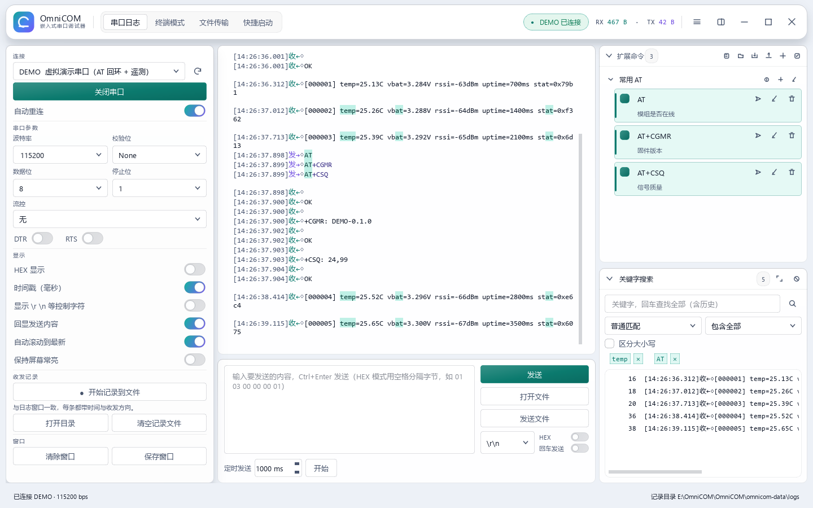
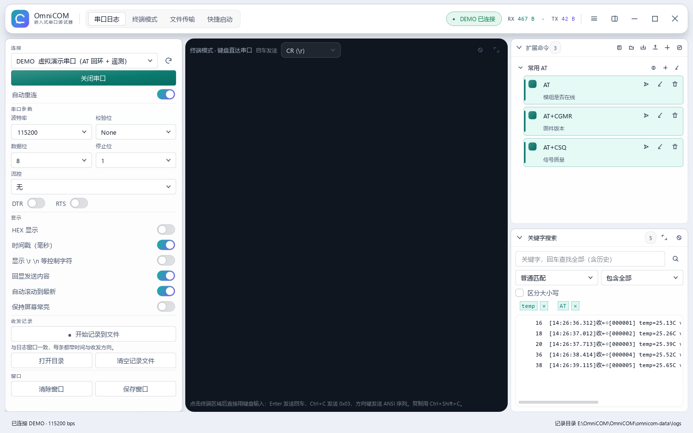
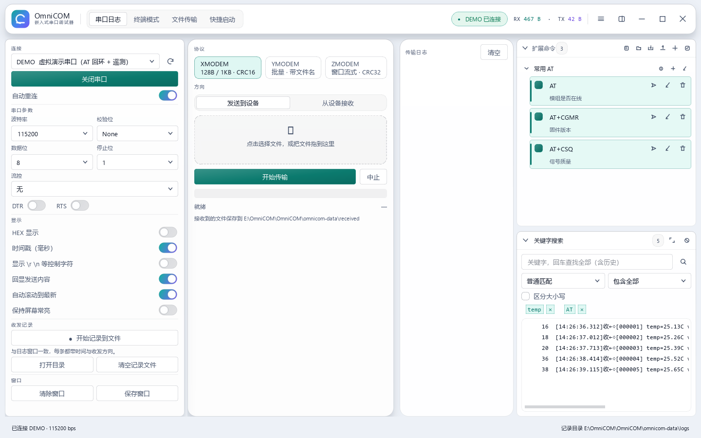
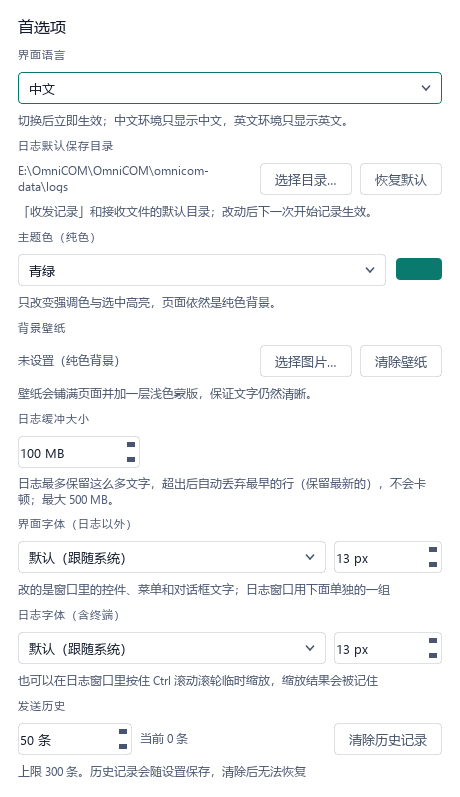
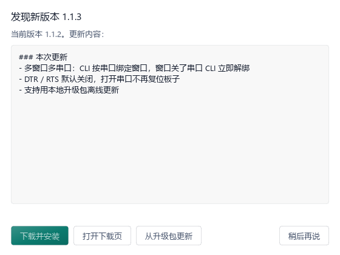
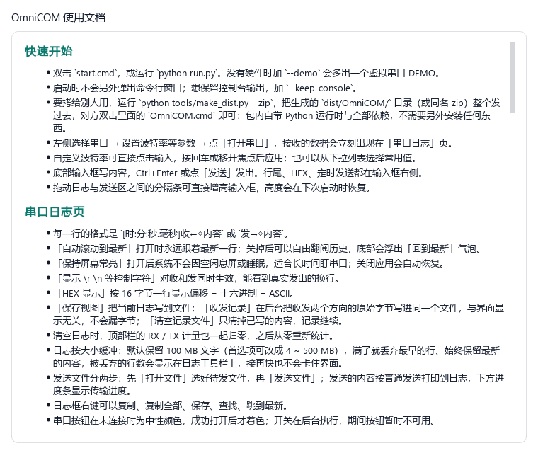
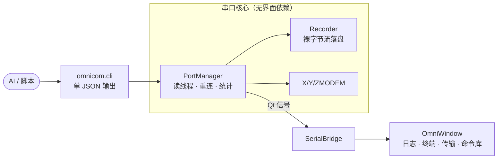

<div align="center">


# OmniCOM

**嵌入式串口调试工作台：一个窗口替代串口助手、终端、传输工具与脚本接口。**


[快速开始](#快速开始) · [功能](#功能) · [便携包](#免安装便携包) · [命令行接口](#命令行接口) · [使用说明](#使用说明) · [验证](#验证)

</div>

---

## 为什么用它

嵌入式调试通常是四五个工具来回切换：一个看串口、一个发命令、一个传固件，
再开一个脚本记日志。OmniCOM 把这些收进一个原生窗口里，并且**不引入任何运行时负担**——
没有本地 web 服务、没有浏览器、没有随包分发的自编译可执行文件。

| | 常见做法 | OmniCOM |
| --- | --- | --- |
| 界面 | 网页套壳 / 单个文本框 | 原生 Qt 窗口，白色主题，液态玻璃面板 |
| 命令管理 | 手写脚本或记事本 | 可分组、可备注、可导入导出的命令库 |
| 传输 | 另开协议工具 | 内置 XMODEM / YMODEM / ZMODEM |
| 自动化 | 只能手点 | 单 JSON 输出的 CLI，供 AI 与脚本直接调用 |
| 分发 | 装 Python、装依赖 | 免安装便携包，解压即用 |

### 它解决的四个具体问题

**1. 日志看得见、也留得住。** 每行都带毫秒时间戳与收发方向；不可见字符（CR / LF / 0x00）可以显式画出来，排查协议时不用猜。日志按**字节预算**缓冲（默认 100 MB，首选项可调到 4 ~ 500 MB），超限先丢最早的行，丢了多少行一直显示在工具栏上——接得再快也不会把界面拖死，也不会悄悄丢字节。

**2. 命令不是一次性输入。** 命令库支持分组、备注、行尾、延时、周期定时与 HEX，可以整组「依次发送」、导出成 JSON 给同事、粘贴多行自动拆分。分组折叠是即点即应（不重建列表、不写盘）。

**3. 固件传完不用换工具。** XMODEM / YMODEM / ZMODEM 内置；普通文件发送按普通发送写进日志，带进度条与实时速率；接收到的文件自动落进 `omnicom-data/received/`。

**4. 机器也能操作它。** 同一个入口还是 CLI：`stdout` 只有一个 JSON 文档，AI 或脚本可以直接 `json.loads`。窗口开着的时候，CLI **不抢串口**——它把请求交给已经开着该串口的那个窗口，所以你屏幕上看到的日志就是 CLI 看到的内容；窗口关了串口，CLI 的绑定立刻结束，不会往空口里静默写数据。

### 一些刻意的取舍

- **不做网页版**：没有本地 HTTP 服务、没有浏览器内核，窗口就是全部界面。
- **不发布自编译 exe**：便携包内是官方 CPython 运行时 + 裁剪过的 Qt 绑定，双击 `OmniCOM.cmd` 即可，既不触发杀软误报，也不需要安装任何东西。
- **设置放在文件里**：`settings.ini` 与每窗口 `window-<n>.ini`，便携包拷到别的机器不会继承旧注册表，也不会被别的版本覆盖。
- **中英文严格隔离**：中文界面只出现中文，英文界面只出现英文（连右键菜单也是），测试里有一条专门扫描英文界面里的中文字符。
- **默认不拉 DTR / RTS**：很多 USB 串口板子把 DTR 经电容接到 RESET，一开串口就复位——所以默认不动，需要时手动打开。

## 界面



<sub>1440×900 · 左侧串口与显示选项，中间「串口日志 / 终端模式 / 文件传输」，右侧命令库与关键字搜索，底部输入框与定时发送。</sub>

<table>
<tr>
<td width="33%" valign="top"><br>
<sub><b>终端模式</b>：键盘直接进串口，Enter / Ctrl+C / 方向键按设备要求发送。</sub></td>
<td width="33%" valign="top"><br>
<sub><b>文件传输</b>：XMODEM / YMODEM / ZMODEM 收发，进度与吞吐实时可见。</sub></td>
<td width="33%" valign="top"><br>
<sub><b>首选项</b>：中英文、日志缓冲、字体、主题色、壁纸、发送历史。</sub></td>
</tr>
</table>

<table>
<tr>
<td width="50%" valign="top"><br>
<sub><b>软件更新</b>：在线查新，也可以选一个本地升级包离线安装。</sub></td>
<td width="50%" valign="top"><br>
<sub><b>使用说明</b>：随程序内置，与这份 README 同源，永不脱节。</sub></td>
</tr>
</table>

截图由 `python tools/make_screenshots.py` 用真实程序渲染（虚拟串口 DEMO），不是拼的示意图。

## 功能

<table>
<tr><td width="50%" valign="top">

**收发自检**

- 毫秒时间戳、方向标记、不可见字符可视化
- HEX 收发、定时发送、命令延时
- 按**字节预算**缓冲日志（默认 100 MB）
- 超限时弃旧留新，丢弃行数在界面可见
- 绝不静默丢字节，任何丢失都会计数上报

**命令库**

- 分组折叠即点即应，不写盘、不重建
- 每条命令可备注，注释与命令左对齐
- 单条 / 整组导出导入，同名分组自动合并
- 粘贴多行文本自动拆分入列

</td><td width="50%" valign="top">

**传输与终端**

- XMODEM / YMODEM / ZMODEM 收发
- 发送文件按普通发送写入日志并显示进度
- 终端页支持常见 ANSI 光标与颜色指令
- 收发双向同时记录到同一个文件

**工程化**

- 中英文界面严格隔离，无混排
- 插件系统：一个目录一个插件，复制即可用
- 关键字搜索支持普通 / 模糊 / 整词 / 正则
- 快捷启动上下两区，多窗口独立绑定

</td></tr>
</table>

## 快速开始

```bash
git clone https://github.com/Fatmear/OmniCOM.git
cd OmniCOM
start.cmd                  # 或 python run.py
```

需要 Python 3.13 与 PySide6：

```bash
python -m pip install -r requirements.txt
```

没有硬件也能完整试用：

```bash
python run.py --demo       # 内置虚拟串口 DEMO：回 AT 指令并周期性输出遥测
```

## 免安装便携包

```bash
python tools/make_dist.py --check --zip
```

产物：

```
dist/OmniCOM/                 # 98 MB，自带运行时
├── OmniCOM.cmd              # 双击启动（无控制台窗口）
├── console.cmd              # 同上，保留控制台以便看报错
├── OmniCOM.pyz              # 程序本体（同时是一份可读的源码归档）
├── CLI.md / AI-GUIDE.md     # 给 AI 与脚本用的命令行接口说明
├── runtime/                 # 官方 CPython embeddable + 裁剪后的 Qt 绑定
├── assets/  plugins/  logo.png
└── README.md / README.en.md

dist/OmniCOM-1.1.3-win64.zip
```

解压后直接双击 `OmniCOM.cmd`，目标机**不需要安装 Python、PySide6 或任何依赖**，
整个目录可以拷到 U 盘或另一台电脑。首次运行会在旁边生成 `omnicom-data/`。

## 命令行接口

同一个入口也是机器接口——`stdout` 只有一个 JSON 文档，可直接 `json.loads` 或 `| jq`：

```bash
OmniCOM.cmd cli info                      # 环境自检
OmniCOM.cmd cli ports                     # 列出串口
OmniCOM.cmd cli send --port COM3 --data "AT" --expect OK --wait 2
OmniCOM.cmd cli monitor --port COM3 --duration 5 --grep ERROR
OmniCOM.cmd cli transfer --port COM3 --proto y --dir send --file app.bin
OmniCOM.cmd cli session --port COM3 --script steps.json   # AI 主入口
OmniCOM.cmd cli selftest                  # 无硬件端到端自检
```

从源码运行等价于 `python -m omnicom.cli`。完整参考见 [`docs/CLI.md`](docs/CLI.md)。

## 架构



界面只通过 `SerialBridge` 的信号与串口交互，驱动的打开、关闭与线程回收都发生在
界面线程之外——窗口卡住不会连带丢失接收数据。

## 验证

```bash
python tools/acceptance_test.py     # 需求对账：每条需求都有可执行证据
python tools/ui_selftest.py         # GUI 端到端（离屏，无需硬件）
python tools/protocol_selftest.py   # X / Y / ZMODEM 内存环回
python -m ruff check .              # 代码风格
```

需求条目在 `project-context/REQUIREMENTS.md`，历史缺陷与结论在
`project-context/LEDGER.md`。

## 数据位置

| 路径 | 内容 |
| --- | --- |
| `omnicom-data/logs/` | 接收记录（原始字节） |
| `omnicom-data/received/` | 协议接收到的文件 |
| `omnicom-data/commands.json` | 扩展命令与分组 |
| `omnicom-data/plugins/` | 后加进来的插件 |
| `omnicom-data/plugin-data/<id>/` | 每个插件自己的数据 |

可用环境变量 `OMNICOM_DATA_DIR` 把整份数据放到别处。

## 使用说明

### 1. 快速开始

* 双击 `start.cmd`，或运行 `python run.py`。没有硬件时加 `--demo` 会多出一个虚拟串口 DEMO。
* 启动时不会另外弹出命令行窗口；想保留控制台输出，加 `--keep-console`。
* 要拷给别人用，运行 `python tools/make_dist.py --zip`，把生成的 `dist/OmniCOM/` 目录（或同名 zip）整个发过去，对方双击里面的 `OmniCOM.cmd` 即可：包内自带 Python 运行时与全部依赖，不需要另外安装任何东西。
* 左侧选择串口 → 设置波特率等参数 → 点「打开串口」，接收的数据会立刻出现在「串口日志」页。
* 自定义波特率可直接点击输入，按回车或移开焦点后应用；也可以从下拉列表选择常用值。
* 底部输入框写内容，Ctrl+Enter 或点「发送」发出。行尾、HEX、定时发送都在输入框右侧。
* 拖动日志与发送区之间的分隔条可直接增高输入框，高度会在下次启动时恢复。

### 2. 串口日志页

* 每一行的格式是 `[时:分:秒.毫秒]收←◇内容` 或 `发→◇内容`。
* 「自动滚动到最新」打开时永远跟着最新一行；关掉后可以自由翻阅历史，底部会浮出「回到最新」气泡。
* 「保持屏幕常亮」打开后系统不会因空闲息屏或睡眠，适合长时间盯串口；关闭应用会自动恢复。
* 「显示 \r \n 等控制字符」对收和发同时生效，能看到真实发出的换行。
* 「HEX 显示」按 16 字节一行显示偏移 + 十六进制 + ASCII。
* 「保存视图」把当前日志写到文件；「收发记录」在后台把收发两个方向的原始字节写进同一个文件，与界面显示无关，不会漏字节；「清空记录文件」只清掉已写的内容，记录继续。
* 清空日志时，顶部栏的 RX / TX 计量也一起归零，之后从零重新统计。
* 日志按大小缓冲：默认保留 100 MB 文字（首选项可改成 4 ~ 500 MB），满了就丢弃最早的行、始终保留最新的内容，被丢弃的行数会显示在日志工具栏上，接再快也不会卡住界面。
* 发送文件分两步：先「打开文件」选好待发文件，再「发送文件」；发送的内容按普通发送打印到日志，下方进度条显示传输进度。
* 日志框右键可以复制、复制全部、保存、查找、跳到最新。
* 串口按钮在未连接时为中性颜色，成功打开后才着色；开关在后台执行，期间按钮暂时不可用。

### 3. 终端模式页

* 这是给 linux 串口控制台用的：点一下终端区域，键盘输入直接送进串口。
* Enter 发送回车（可选 CR / LF / CRLF），Ctrl+C 发送 0x03，方向键发送 ANSI 序列。
* 支持 CR 回到行首覆盖、退格、TAB 对齐、ANSI 颜色，以及清屏序列。
* 复制用 Ctrl+Shift+C，粘贴用 Ctrl+Shift+V（普通 Ctrl+C 会当作中断字符发出）。

### 4. 串口参数

* 左侧的 DTR / RTS 默认**都不拉**：很多 USB 串口板子把 DTR 经电容接到 RESET，拉高等于一开串口就复位；需要时再打开开关。

### 5. 文件传输页

* 选择 XMODEM / YMODEM / ZMODEM，设置方向与文件，点开始。
* 接收的文件保存在 `omnicom-data/received/`。
* 传输期间串口被独占，日志页不打印，避免把协议字节弄脏。

### 6. 扩展命令

* 右侧栏的命令可以点一下直接发送，也可以勾选多条后「依次发送」（每条按自己的延时）。
* 「分组」用来归类：点文件夹图标新建分组，可以给分组写备注；分组可折叠。创建和改名不允许与已有分组同名，首尾空格不计。
* 每条命令与发送、编辑、删除按钮排在同一主行，色条区分选中状态；备注在命令下方以小字显示，与命令文字左对齐，悬停可查看完整内容和延时。
* 每条命令支持备注、行尾、延时、周期定时发送、HEX。
* 右键一条命令可以移动分组；顶部导出按钮统一选择要导出的命令或分组。
* 导出的 JSON 在另一台电脑上「导入」即可使用，分组会自动合并。
* 粘贴多行命令会自动拆分成多条。

### 7. 关键字搜索

* 输入关键字回车，会搜索**整个日志（含此前的历史）**，结果按「行号 + 内容」列出。
* 选中日志文字后右键「查找」，会替换旧查询并立即按普通文本搜索；多行选区按行匹配任一项。
* 双击任意一行跳到日志原文并高亮。
* 匹配方式：普通 / 模糊（字符按顺序出现即可）/ 全词 / 正则表达式；另有「区分大小写」开关。
* 右上角箭头按钮可把结果全窗口显示，Esc 退出。

### 8. 插件

* 插件是一个独立目录，放在 `plugins/` 或 `omnicom-data/plugins/` 下，每个插件在顶部占一个标签页。
* 把一个插件目录整个复制到另一台电脑的 `plugins/` 下，点「插件 → 刷新插件」就能用。
* 自带「快捷启动」插件：上方是快捷方式（点一下新开一个窗口），下方是正在运行的窗口（点一下切过去）；
* 两排都支持拖拽排序，右键可以重命名——下排按窗口命名，所以两个记事本可以分别叫 A、B，长名字会自动换行不遮挡。
* 上排「从列表移除」只删快捷方式，不关闭已开窗口；下排「结束这个窗口」只关那一个窗口。

### 9. 首选项与语言

* 「设置 → 首选项」里可以切换界面语言：中文环境只显示中文，英文环境只显示英文，包括右键菜单。
* 同一页还能设置日志缓冲大小（4 ~ 500 MB，默认 100 MB）和「收发记录」的默认保存目录、切换主题色（只改强调色与选中高亮），或选一张图片当壁纸：有壁纸时各面板会变成液态玻璃（取面板后方的模糊壁纸再叠一层半透明白），鼠标提示框也是同款玻璃；没有壁纸就是原来的纯白面板。底部的状态文字不加框也不加底色，直接压在背景上。
* 切换立即生效，不需要重启。

### 10. 命令行（给脚本 / AI 用）

* `python -m omnicom.cli ports` 列出串口；`send` 发送并等待应答；`read` 读取；`monitor` 流式输出。
* `session --script 文件.json` 可以跑一段脚本化的收发流程。
* 所有命令的 stdout 都是一个 JSON 文档，详细说明见 `docs/CLI.md`。

### 11. 软件更新

* 顶部菜单「软件更新」会在窗口空闲后安静地查一次 GitHub（失败不弹窗）；有新版本时菜单项后面带 NEW、按钮亮红点。
* 对话框显示当前版本和更新说明，点「下载并安装」会下载到本地，**下次启动**在窗口出现前完成替换。
* 更新只覆盖程序文件：`omnicom-data/` 里的命令库、收发记录、设置和自己的插件一律不动。
* 没有外网也能更新：点「从升级包更新」，选一个 `OmniCOM-<版本>-win64.zip`；版本号从包内读取（文件被改名也认），不是 OmniCOM 包的 zip 会被直接拒绝。

### 12. 典型工作流

* **抓一段启动日志**：打开串口 → 点「收发记录」→ 给板子复位 → 复现完就点「停止记录」，文件在 `omnicom-data/logs/`，点「打开目录」直达。记录的是原始字节，界面怎么显示都不影响它。
* **烧完固件验证**：先在命令库建一组「验证」，把 `AT`、`AT+CGMR`、`AT+CSQ` 存成三条，设置好行尾和延时，之后每次只要点一次「依次发送」，结果直接出现在日志里。
* **让 AI 帮忙看**：窗口开着、串口开着，直接跑 `python -m omnicom.cli log --limit 50`，AI 读到的就是屏幕上那段内容。

### 13. 快捷键一览

* `Ctrl+Enter` 发送（回车发送关闭时，回车只换行，`Shift+Enter` 也是换行）。
* `↑` / `↓` 在输入框第一行翻发送历史；历史默认 50 条，首选项可调到 5 ~ 300 条并一键清空。
* `Ctrl+C` 复制日志选中内容（终端页是 `Ctrl+Shift+C`，因为 `Ctrl+C` 要当 0x03 发出去）。
* `Ctrl+滚轮` 在日志上缩放日志字号，不影响界面其它字号，缩放值会被记住。
* 日志里右键：复制 / 复制全部 / 保存 / 查找 / 跳到最新。

### 14. 串口与设备

* 端口下拉框显示「端口号 + 设备名」，例如 `COM139  USB-Enhanced-SERIAL CH340`；名字太长时悬浮可看完整名称与硬件 ID。
* 打开失败常见原因：被别的程序占着（另一个串口助手、虚拟机、厂商烧写工具）；驱动没装；线是充电线没有数据线芯。先点刷新重新枚举，再换一个口试试。
* 拔插设备时保持「自动重连」打开，OmniCOM 会认回同一个设备，而不是同名的新设备。
* DTR / RTS 默认都不拉；如果板子需要拉高才启动，打开开关即可，这个选择会记住。

### 15. 多窗口

* 可以同时开多个窗口，每个窗口各自一个串口、各自一份日志，互不干扰；窗口的尺寸、分栏、发送框高度分别记住，下次启动复原。
* 「快捷启动」插件的上排是快捷方式，点一下就是新开一个窗口——同时调两块板子时，一块板一个窗口，抓日志不会串。
* 命令行同样能区分：它按**串口名**找窗口。`cli state --port COM5` 只会问开着 COM5 的那个窗口；想指定某个窗口还可以 `--window <PID>`。

### 16. 备份与迁移

* 整个 `omnicom-data/` 目录就是全部用户数据：命令库、收发记录、收到的文件、设置、自己的插件。换电脑时把这个目录拷过去即可（也可以用 `OMNICOM_DATA_DIR` 把它放到同步盘里）。
* 升级（在线或本地升级包）只替换程序文件，`omnicom-data/` 一律不动，你自己放在 `plugins/` 里的插件也不会被包里的同名插件覆盖。
* 命令库还可以单独导出成 JSON，只带某几条或某一组，方便同事之间传。

### 17. 遇到问题先看这里

* **日志不刷新 / 停在某一行**：检查「自动滚动到最新」是否被关掉；关掉时底部会浮出「回到最新」气泡。
* **收到一半乱码**：多半是波特率和设备不一致，或者开了 `HEX 显示` 却在看文本；也可能是控制字符被隐藏，打开「显示控制字符」就能看清楚。
* **发送没反应**：确认串口已打开、行尾设置和设备要求一致（很多 AT 设备必须要 CRLF）；开了「HEX 发送」时输入框里必须是十六进制，纯文本不会发出去。
* **文件传输卡住**：协议传输期间串口被独占，两端必须同时进入同一个协议；接收端要先进入接收模式，再点发送。
* **界面被拉坏**：`设置 → 重置布局` 恢复默认三栏，窗口大小和分栏都会回到初始值。
* **想确认有没有丢日志**：日志工具栏显示「已丢弃 N 行」，N 一直是 0 就说明一条都没丢。

### 18. 数据放在哪

* `omnicom-data/logs/` 收发记录（首选项改了目录后按新目录）；`omnicom-data/received/` 协议收到的文件；
* 右下角「记录目录」显示的就是当前实际保存收发记录的位置，点「打开目录」会直接打开它。
* `omnicom-data/commands.json` 扩展命令；`omnicom-data/plugins/` 后加的插件。

---

## 许可

MIT License —— 见 [`LICENSE`](LICENSE)。可自由用于商业项目、修改与再分发，
请保留版权与许可声明。

<div align="center">
<sub>用 Qt / PySide6 构建 · 为嵌入式调试而生</sub>
</div>
