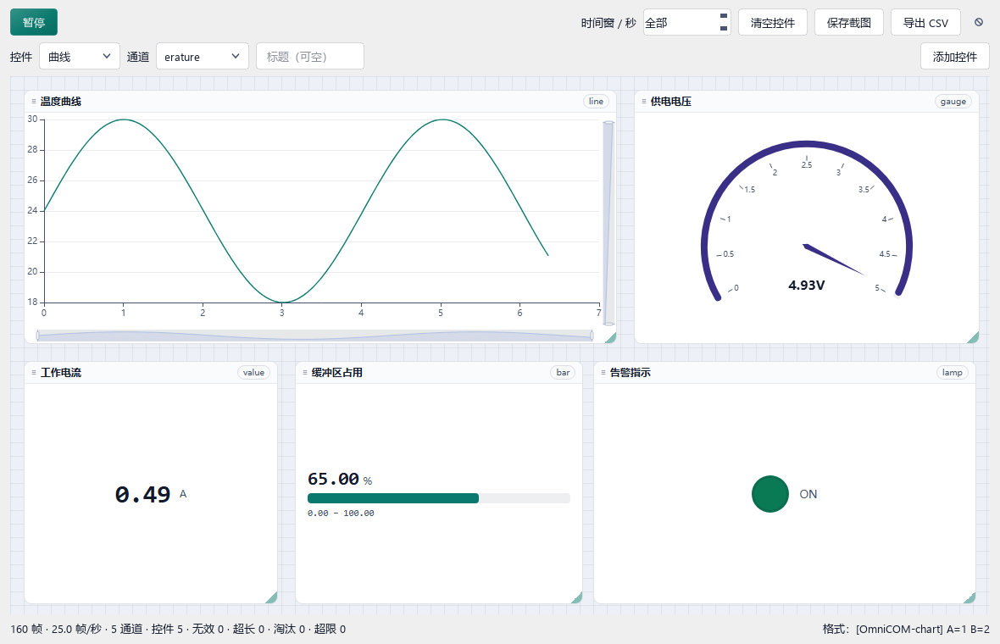

# Plugins And Live Charts

Two plugins ship with OmniCOM, and each has its own section below:

- [Dashboard (data charts)](#dashboard--chart) - turn one line of device text into live cards.
- [Launcher](#launcher--launcher) - one click for a shortcut or an already-open window.

## Dashboard / `chart`



Five kinds of card, each bound to one channel, every value parsed from a
`[OmniCOM-chart]` line by the real receive path. The picture is produced by
`python tools/make_plugin_screenshots.py`, which reads the rendered DOM back
before writing the file - a card still showing `--` fails the run rather than
being documented as if it worked.

1. Open the **Dashboard** tab. Channels appear as soon as a line arrives, so nothing has to be declared up front.
2. Type a channel name in the picker and press the kind you want (曲线 / 仪表盘 / 数值 / 进度条 / 指示灯).
3. Drag the card into place and drag its lower-right corner to resize.

The `[OmniCOM-chart]` grammar, the 128-channel and 5000-sample ceilings, the
bar's range semantics and the two per-card zoom sliders are all specified in
[Chart Protocol](#chart-protocol) below.

Widgets in the shipping build:

| Kind | Source of the number | Range handling |
|---|---|---|
| 曲线 (line) | latest retained sample | autoscale, or the card's own min/max |
| 仪表盘 (gauge) | latest retained sample | points inside min–max |
| 数值 (value) | latest retained sample | none; formatted with 2 decimals by default |
| 进度条 (bar) | latest retained sample | `(value - min) / (max - min)`, clamped and red above max |
| 指示灯 (lamp) | latest retained sample | lit for any non-zero value |

## Launcher / `launcher`


Two rows with two different jobs. The upper row is what you *can* start, the
lower row is what is *already* running. The picture is produced by
`tools/make_plugin_screenshots.py` from a live page: the lower row is a genuine
`EnumWindows` scan of the windows that script started, so no private document
title from the build machine ends up in a public image.

### Top row - shortcuts

- A click starts a new instance of the program. Two boards at once therefore
  means two windows, each with its own port, so their logs never interleave.
- **Remove from list** deletes the shortcut only; an already-open window keeps
  running.
- The list is `omnicom-data/plugin-data/launcher/apps.json`. Only `path` is
  required; `name` is a display label you choose, so a shortcut may be called
  板子 A even when the target is a generic terminal executable.

### Bottom row - running windows

- A click brings that window to the foreground instead of opening another one.
- Several windows of one program are listed separately and carry an instance
  badge, so two open notes files can be told apart.
- The caption defaults to the window title and wraps instead of eliding, so a
  long title stays readable.
- **End this window (process)** closes exactly that window and nothing else.
- Renaming a running window stores your own label (A, B, ...) against that
  window, and the label survives the next scan.

### Shared behaviour

Both rows are rebuilt from a background scan every 4 s while the page is
visible, and both can be reordered by dragging. The scan never runs on the GUI
thread, so an unresponsive program cannot freeze the window (L-070).

## Runtime

Open **Plugins > Plugin Store** to inspect installed and available plugins.
Each entry shows installed/latest versions; a red dot at its upper-right marks
an available update. Check updates fetches all configured catalogs off the GUI thread.
Configure catalog URLs only in **Preferences > Plugin catalogs**, one per line.
Duplicate URLs are queried once, in configured order. Results are combined by
plugin ID: the newer numeric version wins; equal versions prefer the first source.
Relative package URLs resolve against their own catalog. A failed source does not
block other sources; its existing cache is retained and a partial-failure status
is shown. Removed sources no longer contribute cached entries. Old single-source
preferences are preserved, with the old official endpoint mapped to the new one.
Install/update/uninstall reload plugin pages. Serial logging continues; plugin
subscriptions are suspended during a package mutation. Uninstall preserves
`omnicom-data/plugin-data/<id>/`, including channel visibility preferences.

Plugins execute trusted Python code with user permissions, **not in a sandbox**.
Only use a trusted HTTPS catalog. SHA-256 detects package mismatch; it does not
authenticate a malicious catalog. HTTP is allowed only on loopback for tests.
Local `file:` catalogs are supported for offline administration.

The initial catalog lists bundled Chart and Launcher plugins. User-installed
copies in `omnicom-data/plugins/` override bundled copies. Removing a bundled
plugin disables it without modifying program files; installing it again restores
it. File-operation failures preserve the previous package. Update backups remain
under `omnicom-data/plugin-updates/`; startup errors are reported by the host.
Windows may keep a plugin's native DLLs mapped until the application exits;
backups are therefore retained rather than forcibly deleted. Python plugin code
is reloaded immediately; changes to already-imported native dependencies take
effect after an application restart, without replacing the application package.

## Chart Protocol

Send ASCII, terminated by LF or CRLF:

```text
[OmniCOM-chart] AA=11 BB=1.1
[OmniCOM-chart] temperature=-2.5 supply=3.30 current=1.2e-3
```

Names match `[A-Za-z_][A-Za-z0-9_.\-/]{0,127}`. Fields are separated by
whitespace. Duplicate names, malformed values and non-finite numbers reject the
whole frame and increment a visible counter. Other serial lines are ignored.
Split/coalesced serial chunks are supported. A frame is limited to 65536 bytes;
overlong input is counted and discarded until the next LF, then parsing resumes.

Channels appear dynamically and can be bound to dashboard cards. Five widget
kinds are available: 曲线 (line), 仪表盘 (gauge), 数值 (value), 进度条 (bar)
and 指示灯 (lamp). A **进度条** card fills a flat track to
`(value - min) / (max - min)` of its own range: the readout and the `min – max`
captions under the track are formatted from the card's unit and decimals, a
reading below the minimum clamps to an empty bar, and one above the maximum
clamps to full but turns red so an out-of-range frame is not mistaken for a
healthy full bar. Cards without data show `--` and an empty track. The bar is
plain DOM/CSS - it creates no ECharts instance - so a live bar costs one style
write per frame.

Missing fields
leave that channel's existing history unchanged. At most 128 channels are
retained; rejected excess channels are counted. Each channel retains its most
recent 5000 samples in memory; evictions are counted. The time window defaults
to All, or can be set to a number of seconds. All sends every retained sample
for each visible curve without downsampling. An old 10-second default is migrated
once; other saved windows are preserved. History is not restored after restarting
the plugin. This limit does not remove bytes from the serial log or capture.
Pausing freezes rendering, not reception. CSV exports retained values for all
channels, including those not shown on the dashboard.

The x-axis is relative **host receive time**, in seconds. Frames received in the
same serial chunk share a timestamp; this is not a device sampling clock.

Each 曲线 card carries **two independent zoom sliders**: the horizontal strip
under the plot and the vertical strip at its right edge. Dragging either strip
narrows or widens that axis only, and the chosen range survives live refresh -
the page owns the range and feeds it back on every frame, because an ECharts
option that carries `start`/`end` would reset it ~30 times a second. Pressing on
a strip zooms instead of dragging the card; the rest of the curve area still
drags it. The dashboard deliberately has **no page-level Ctrl+wheel zoom**: that
Chromium gesture scaled the whole document (cards, labels and toolbar) and could
only be undone by restarting. The Qt side swallows it, and a plain wheel still
scrolls as before.

The dashboard has **no edit mode** and **no switch widget**. Cards are draggable
at all times (the card body is the handle, the lower-right corner resizes, the
hover × deletes), and the 16 px snap grid is painted permanently as an alignment
guide instead of appearing only while editing. Everything that needs a command
sent belongs in the command library, not on a dashboard card.

## Measured Performance

Reproduce: `python tools/plugin_selftest.py --benchmark`.
Historical evidence for the previous PyQtGraph implementation:
`.artifacts/chart-benchmark.json`. Windows x64, CPython 3.13.14, Fusion,
application fonts, 1050×650 offscreen widget. These numbers do not measure the
current ECharts dashboard and are not guaranteed rates on every computer.

| Channels | ASCII bytes/line | Parser frames/s | Parser MB/s | 5000-point render mean / p95 | Conservative capacity |
|---|---:|---:|---:|---:|---:|
| 2 | 36 | 309619 | 11.15 | 22.7 / 28.7 ms | 44 FPS |
| 8 | 96 | 103344 | 9.92 | 40.4 / 57.1 ms | 25 FPS |
| 32 | 380 | 26892 | 10.22 | 100.3 / 122.2 ms | 10 FPS |

The parser benchmark uses 20000 frames per case. Rendering uses 60 frames per
case, includes data conversion, event processing, and an additional real canvas
grab, so it is a conservative load rather than an actual timer FPS claim.
The normal refresh timer is 33 ms (at most about 30 FPS). Thick 1.5-pixel pens
were measured at 47/111/330 ms per frame; 1-pixel pens reduced CPU raster cost.
Rendering, not ASCII parsing, dominates the high-channel-count workload.

`[OmniCOM-chart] AA=11 BB=1.1` plus LF is **29 bytes**. At 8N1, useful wire
bytes/s = baud/10, so theoretical line rates are approximately:

| Baud | Useful bytes/s | Two-field example lines/s |
|---:|---:|---:|
| 115200 | 11520 | 397 |
| 921600 | 92160 | 3178 |
| 3000000 | 300000 | 10345 |

CRLF adds one byte. Longer names/values reduce these rates. These wire limits
are theoretical and exclude device formatting, USB scheduling and other traffic.
Typical low-channel-rate telemetry does not need HEX. Consider a versioned binary
protocol for many high-rate channels, device timestamps, sequence/loss detection
or CRC. It should define channel IDs/scales once, then carry timestamp/sequence,
packed samples, length and CRC. Merely printing hexadecimal text is not a binary
protocol and does not inherently save bandwidth. No speculative binary protocol
is implemented in this version. Reduce visible channels/history when plotting
large workloads; switching transport alone will not fix rendering cost.

## Independent Publishing

Build, without modifying or publishing the application release:

```powershell
python tools/make_plugins.py --out .artifacts/plugin-store
```

The command writes ZIPs into `.artifacts/plugin-store` and the JSON into the
repository's `plugins/catalog.json`. The JSON is committed as a repository file,
**never uploaded as a Release asset**. The build does not publish either output.

For an offline catalog alongside its ZIPs:

```powershell
python tools/make_plugins.py --out .artifacts/plugin-store --base-url . --catalog-out .artifacts/plugin-store/catalog.json
```

Enter the resulting `catalog.json` file URI in Preferences. `--catalog-out`
also allows an isolated staging path without overwriting the repository index.

Outputs: one versioned ZIP per plugin and `catalog.json` containing schema 1,
localized metadata, API version, download URL, size and SHA-256. Each ZIP has one
top-level `<id>/` folder with `plugin.json` and its entry module. The dashboard
renders with the Chromium engine that already ships with Qt, so its package is
plain HTML/CSS/JS plus the plugin module and bundles no extra plotting
installation. Build on Windows x64 CPython 3.13.

### Version history and installing an older build (R-178)

Each catalog entry may carry an optional `versions` array so the store can offer
more than the newest build. `tools/make_plugins.py` grows it automatically: every
build re-hashes the ZIPs already sitting in `--out`, reads their own
`plugin.json`, and writes the resulting records into `versions`, newest first.
Publish the new ZIP next to the old ones (do not delete old builds) and the
picker's history is correct on the next catalog build.

```json
{
  "id": "chart", "version": "1.1.2", "api": 2, "url": "...", "sha256": "...",
  "versions": [
    {"version": "1.1.2", "api": 2, "url": "...", "sha256": "...", "size": 364071},
    {"version": "1.1.0", "api": 2, "url": "...", "sha256": "...", "size": 358809}
  ]
}
```

Rules the validator enforces (`validate_catalog`, `version_entries`):

- `version` must appear in `versions` **and** be its newest entry, otherwise the
  head pointer and the picker would disagree - the whole catalog is rejected.
- every entry needs its own `version`, `api`, `url` and `sha256`; a non-head
  entry must also carry a `url` (there is no bundled copy of an old build).
- versions are unique, and at most `MAX_VERSIONS` (100) are accepted because a
  catalog is parsed on the GUI thread and cached as JSON.
- `versions` is optional. A catalog with only the flat fields keeps working: one
  record is synthesised from them.

In the store, each row shows a **version drop-down**. Its caption tracks the
selection, so the same button never means two things: 安装 / 更新 / 降级安装 /
已安装. An older build travels the identical verified path as an update (SHA-256,
`api` check, staged extraction, manifest cross-check, atomic swap, rollback), so
"downgrade" is not a second, weaker code path. Selecting the installed version
disables the button with 已安装这个版本，无需操作. When the newest build is the
installed one, the picker pre-selects the newest *older downloadable* build so a
click can actually do something. An installed build that no catalog carries is
listed with a `local` marker: it is visible and can be removed, but offers no
install action because there is nothing to download.

The default endpoint is the Git repository file:
`https://raw.githubusercontent.com/Fatmear/OmniCOM/main/plugins/catalog.json`.
**This source change does not publish that file or plugin ZIPs.** Until the
repository index is pushed and downloadable packages are available, the UI uses
its offline catalog and reports query failures. Preferences accepts multiple
private or third-party HTTPS catalogs and local test catalogs. The multiline
`OMNICOM_PLUGIN_CATALOG` environment variable provides a default when no setting
is saved. `--base-url` chooses package URL prefixes; upload ZIPs before committing
and pushing the generated repository JSON.

To activate the default public store, publish only plugin ZIPs to a dedicated
`plugin-store` GitHub release or another static HTTPS host. Keep that release
non-latest (`make_latest: false`); never move the main application latest pointer,
hide old releases, move source tags, or republish the app just to update a plugin.
On future updates, bump only the plugin manifest version, build/upload its ZIP,
then commit the generated `plugins/catalog.json`. Do not upload that JSON to
Releases. Keep old versioned ZIPs available for rollback.

The host API is additive version 2: `on_rx(ts_ms, bytes)`, `on_theme(callback)`,
`on_unload(callback)` complement the existing translation/settings/theme API.
Callbacks run on the GUI thread: do bounded work and defer expensive work;
unload must stop timers/workers. A callback failure is surfaced and its receive
subscription is removed without interrupting core serial reception.

## Verification

```powershell
python tools/plugin_selftest.py
python tools/ui_selftest.py
python tools/acceptance_test.py
python -m ruff check .
```

The independent test uses isolated data and a local HTTP server. It covers
catalog completeness, installed/latest states, the update dot, bilingual refresh,
install/update/uninstall/retry, cancellation, hash/manifest/API/path/symlink
rejection, transactional rollback, retained user data, dynamic chart behavior,
streaming parser boundaries, and complete search-result wrapping. It also covers
the R-178 version picker: multi-version catalog parsing, refusal of a catalog
whose head disagrees with `versions`, installing an older build through the same
verified path, the 安装/更新/降级安装/已安装 captions, and the search box.
